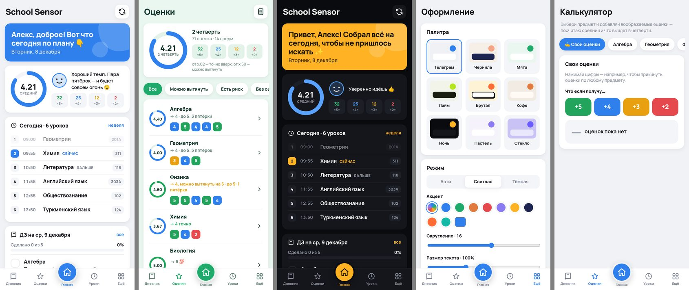
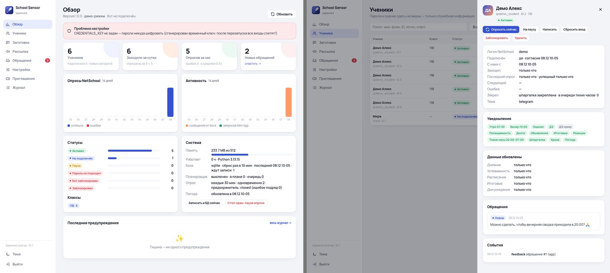

# School Sensor

Неофициальный помощник для электронного дневника **NetSchool 5.10** (ИрТех) — Telegram-бот + Mini App.
Сам заходит в дневник ученика, замечает новые оценки и ДЗ, присылает утреннюю и вечернюю сводки,
считает, что выходит в четверти, и складывает архив картинками, который открывается без интернета.



## Что умеет

**Бот (чат)**
- Подключение: логин → пароль. Сообщение с паролем бот **удаляет сразу**; хранится только
  зашифрованный отпечаток (md5 + длина, Fernet) — ровно то, что нужно сайту школы для входа.
- Уведомления: новые оценки (с реакцией-подписью), новое ДЗ, долги («точки», просрочки), пропуски
  и опоздания, итоговые, объявления школы. Тихие часы — всё копится и приходит утром.
- ☀️ Утренняя сводка (по умолчанию 7:30): погода в Ашхабаде + совет («возьми зонт»), уроки, что сдавать.
- 🌙 Вечерняя (19:00): ДЗ на завтра.
- Команды: `/today` `/tomorrow` `/hw` `/marks` `/debts` `/totals` `/holidays` `/birthdays` `/news`
  `/archive` `/sync` `/settings` `/feedback` `/privacy` `/logout` `/delete`.
- 📌 Закреп «Шпаргалка» (бот сам обновляет) и 📦 архив PNG: оценки, посещаемость, ДЗ на неделю, расписание.
  По воскресеньям — автоматически (только если что-то поменялось).

**Mini App** (кнопка «Дневник» в чате)
- Главная, дневник по дням (с отметкой «сделано»), оценки с прогнозом, расписание, каникулы, именинники,
  объявления, калькулятор «что если получу…», архив, обращение к администратору.
- 9 палитр (Телеграм, Чернила, Мята, Лайм, Брутал, Кофе, Ночь, Пастель, Стекло), свой акцент, светлая/тёмная,
  скругление, размер текста, вид нижней панели, **«Лёгкий режим»** для слабых телефонов.
- ES2017 без фреймворков и CDN (~70 КБ JS), кэш через Service Worker — открывается и при плохой сети.

**Админка** (`/admin` в боте → одноразовый код → веб-панель)
- Обзор (ученики, опросы, ошибки, память, предохранитель), ученики (статусы, пауза, сброс входа, блок),
  заготовки фраз, рассылка, обращения (ответ уходит «от Администратора»), живые настройки, приглашения, журнал.
- **Паролей, оценок и ДЗ учеников в админке нет** — это сделано специально.



## Бережём сайт школы

Сервер у школы старый, поэтому: опрос раз в ~30 минут с разбросом, не больше 2 сессий одновременно,
ночью пауза, в воскресенье и на каникулах — реже. Никаких обходов блокировок: при серии ошибок
**предохранитель** сам ставит опрос на паузу (20 мин → 40 → … до 4 ч) и пишет администратору.
Пока пауза — новые подключения тоже не идут на сайт.

## Стек

Python 3.12 · FastAPI + uvicorn (один процесс: вебхук бота, Mini App, админка, планировщик) · aiogram 3 ·
SQLAlchemy 2 async (Postgres/Neon через asyncpg, SQLite локально) · cryptography (Fernet) · Pillow ·
httpx · BeautifulSoup + lxml. Погода — Open-Meteo (без ключа).

Хостинг рассчитан на бесплатные тарифы: **Render Free** (Docker, 512 МБ) + **Neon Free** (Postgres) +
**cron-job.org** (пинг `/tick`, чтобы сервис не засыпал). Подробно — [docs/DEPLOY.md](docs/DEPLOY.md).

## Запуск локально (демо, без Telegram и без сайта школы)

```bash
python3.12 -m venv .venv && . .venv/bin/activate
pip install -r requirements-dev.txt
APP_ENV=dev DEMO_MODE=1 DEV_MODE=1 python -m app
# Mini App с демо-учеником: http://localhost:8000/app/?dev_user=1
```

`DEMO_MODE` подменяет NetSchool правдоподобными данными, `DEV_MODE` разрешает `?dev_user=` без Telegram
(на проде он игнорируется). Для бота локально: `BOT_TOKEN=… USE_POLLING=1 python -m app`.

Проверить настройки: `python -m app check`. Сгенерировать ключи: `python tools/genkey.py`.

## Тесты

```bash
python -m pytest -q
# те же тесты на настоящем Postgres (как у Neon):
TEST_DATABASE_URL=postgresql://postgres@127.0.0.1:5432/postgres python -m pytest -q
```

~100 тестов: парсеры NetSchool, клиент на моках, калькулятор, хранилище и опрос, предохранитель,
сводки, API Mini App, админка, сценарии бота (фейковый Telegram, без сети). По умолчанию база — SQLite;
весь набор проходит и на Postgres 17.
Тесты на реальных страницах сайта берут образцы из `tests/netschool/fixtures/` и `dumps/` —
в репозитории их **нет** (там ФИО и оценки), без них такие тесты просто пропускаются.

## Структура

```
app/            приложение
  bot/          обработчики бота, клавиатуры, тексты
  web/          FastAPI: main (вебхук, /tick, статика), api (Mini App), admin_api, views
  sync.py       опрос NetSchool → снимки → diffing.py → notifier.py
  scheduler.py  очередь опросов, сводки, шпаргалки, воскресный архив, уборка
  store.py      данные в памяти + пакетная запись в БД (db.py)
  breaker.py    предохранитель (автопауза при ошибках сайта)
  grades.py     прогноз оценок и «сколько пятёрок нужно»
  images.py     PNG архива (Pillow), archive.py — отправка
  phrases.py    заготовки фраз (seed_phrases.py — стартовый набор)
  weather.py    Open-Meteo, school.py — звонки/каникулы, demo.py — демо-данные
netschool/      клиент NetSchool 5.10 (вход, дневник, отчёты, файлы) и парсеры
static/app/     Mini App (index.html, app.js, app.css, sw.js)
static/admin/   админка
assets/         шрифт Manrope (OFL) и логотип (logo-640.png — аватарка бота)
docs/           DEPLOY, ADMIN, PRIVACY, DECISIONS, NETSCHOOL_API
tools/          genkey.py, dump_pages.py / har_to_fixtures.py (для отладки парсеров)
```

## Документы

- [docs/DEPLOY.md](docs/DEPLOY.md) — запуск с нуля: BotFather, Neon, Render, cron-job.org, пилот.
- [docs/ADMIN.md](docs/ADMIN.md) — как пользоваться админкой и что значат настройки.
- [docs/PRIVACY.md](docs/PRIVACY.md) — что и как хранится (можно показывать ученикам).
- [docs/DECISIONS.md](docs/DECISIONS.md) — почему сделано так, лимиты, риски, что не проверено.
- [docs/NETSCHOOL_API.md](docs/NETSCHOOL_API.md) — карта запросов NetSchool 5.10.

## Важно

- Репозиторий держи **приватным**. `.env`, `dumps/`, `tests/netschool/fixtures/` в git не попадают (`.gitignore`).
- `CREDENTIALS_KEY` не теряй и не меняй: без него сохранённые входы не расшифровать — всем придётся
  подключаться заново.
- Бот неофициальный и со школой не связан.
